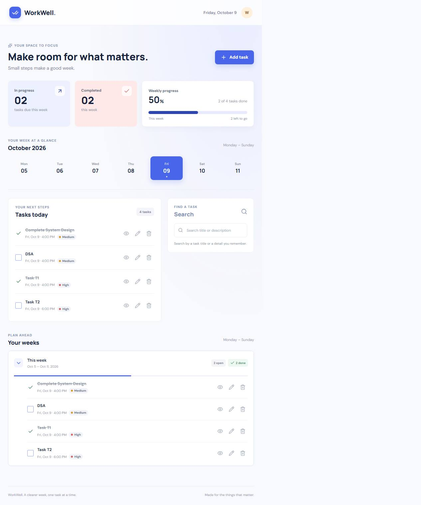

# WorkWell Task Planner

A responsive weekly to-do app built with React, Vite, Express, and MongoDB.

## Screenshot



## Features

- Create, view, edit, search, and delete tasks.
- Group tasks by Monday-to-Sunday weeks and review daily tasks.
- Track in-progress and completed counts; completed tasks can be reopened.
- Set optional low, medium, or high priority.
- Reject past due dates and times in the form and API.
- Store tasks in MongoDB so they persist between app sessions.

## Run locally

### Prerequisites

- Node.js 18 or newer and npm
- MongoDB Community Server running locally, or a MongoDB Atlas URI

MongoDB Compass is a database client; the MongoDB server must also be installed and running.

### Setup

1. From the project root, install dependencies:

   ```powershell
   npm install
   ```

2. Create the server environment file:

   ```powershell
   Copy-Item server/.env.example server/.env
   ```

   The local MongoDB defaults are:

   ```env
   PORT=5000
   MONGODB_URI=mongodb://127.0.0.1:27017/todo_app
   CLIENT_ORIGIN=http://localhost:5173
   ```

   If using Atlas, replace `MONGODB_URI` with your Atlas connection string and allow your IP in Atlas Network Access.

3. Create the client environment file:

   ```powershell
   Copy-Item client/.env.example client/.env
   ```

   The default `VITE_API_URL` is `http://localhost:5000/api`.

4. Start the API and frontend together:

   ```powershell
   npm run dev
   ```

5. Open <http://localhost:5173>. Check API health at <http://localhost:5000/api/health>.

Stop the processes with `Ctrl+C`. Tasks are stored in the `todo_app` database, in the `tasks` collection.

## API

All routes use the `/api` base path.

| Method | Endpoint            | Purpose                          |
| ------ | ------------------- | -------------------------------- |
| GET    | `/health`           | Health check                     |
| GET    | `/tasks?q=keyword`  | List or search tasks             |
| GET    | `/tasks/:id`        | Get one task                     |
| POST   | `/tasks`            | Create a task                    |
| PATCH  | `/tasks/:id`        | Update task fields               |
| PATCH  | `/tasks/:id/status` | Set `in_progress` or `completed` |
| DELETE | `/tasks/:id`        | Delete a task                    |

Task search matches title and description. Create and update requests reject due dates earlier than the current time.

## Checks and formatting

```powershell
npm run build
npm test --workspace=server
npm run format
npm run format:check
```

## Scope

Authentication and deployment are not configured. This app is a single shared task list; add access control before exposing it publicly.
